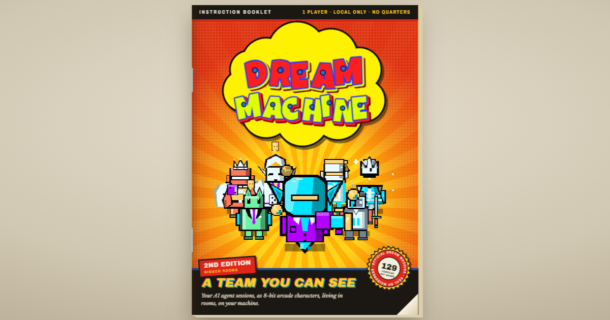
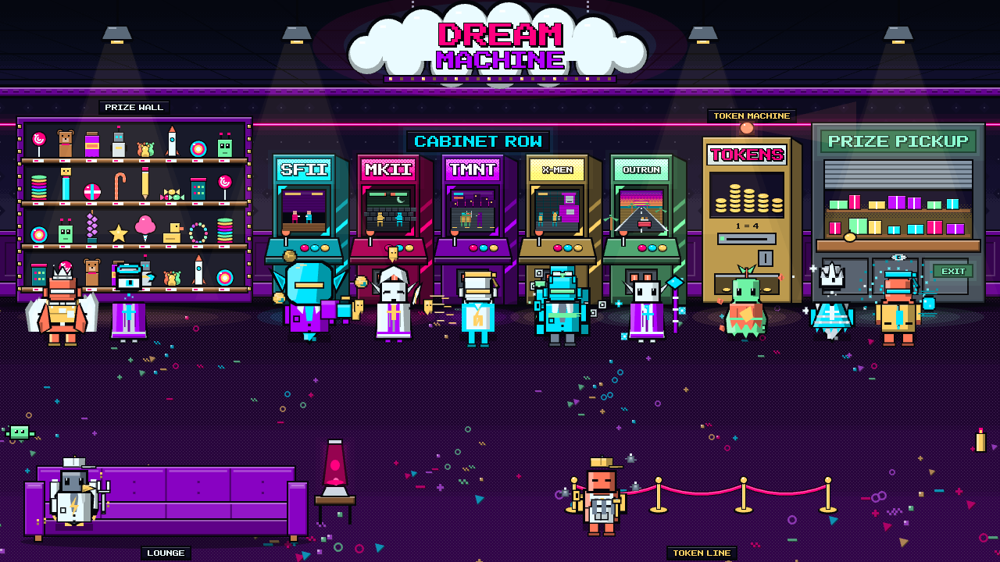
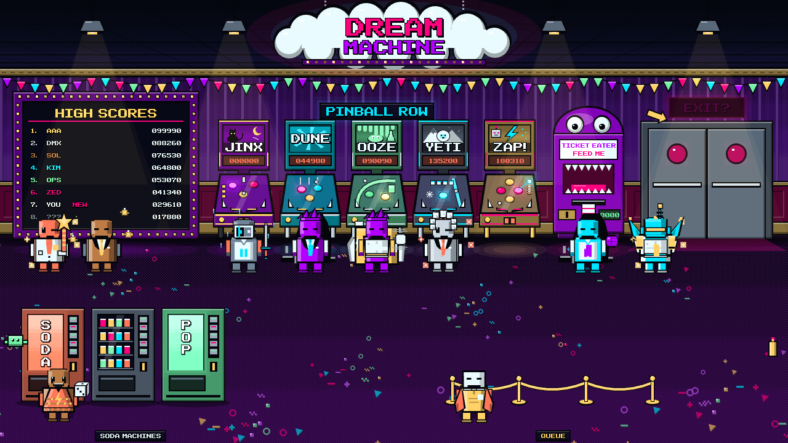
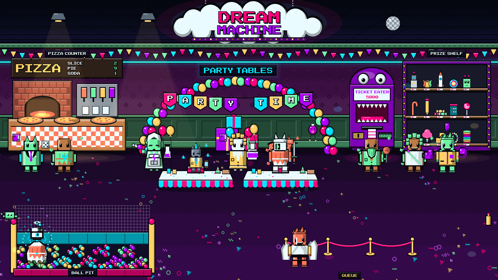
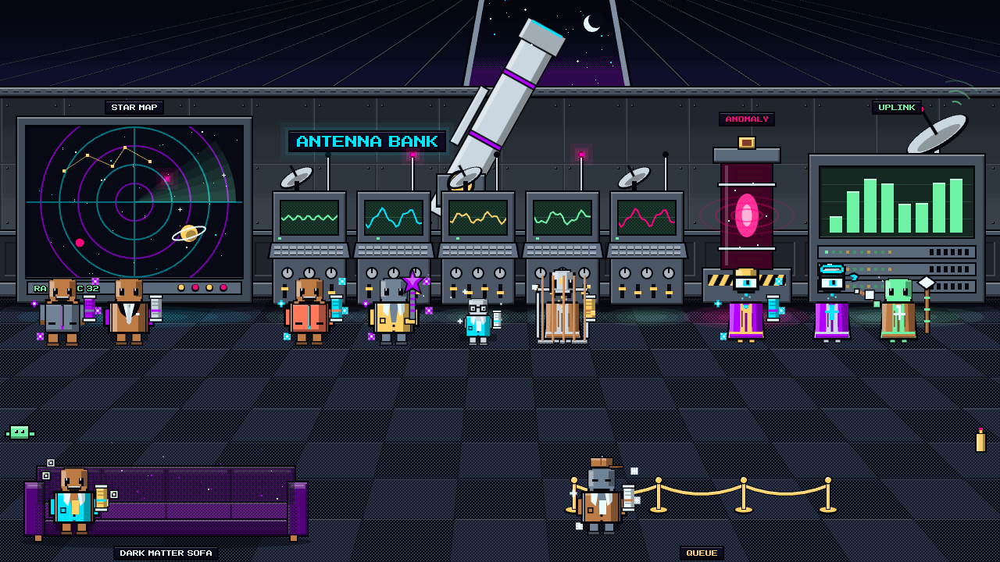
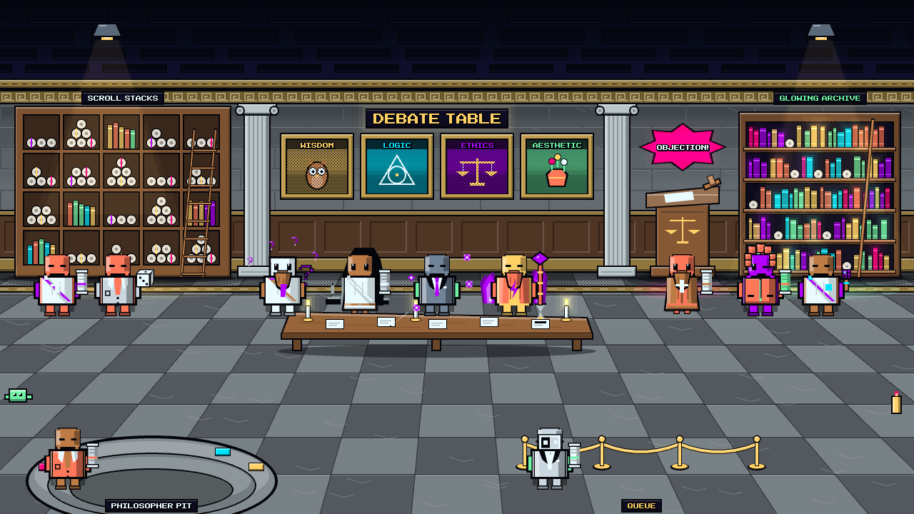

# The Dream Machine

Your AI agent sessions, as 8-bit arcade characters, living in rooms, on your machine.



The Dream Machine is how I watch my AI team work. Every agent session on my computer (Codex tasks, Claude Code sessions, TeamLoop reviewers) shows up as a little pixel character in an arcade room, so one glance tells me who is working, who is stuck and who is waiting on me.

This repo is the public half: the character engine, the five arcade rooms, a one-file starter, and **The Manual**, the instruction booklet that doubles as the case study. Read it at **https://starforge-dream-machine.netlify.app/**.

There are no sprite files. Every character compiles from a recipe (body, head, face, hat, outfit, shell, prop, aura, motif and three colors), drawn on a canvas at a 2-pixel grid. 129 names have hand-designed recipes. Any other name gets built from its letters. Same name, same guy, every time.

## Try it in ten seconds

Download [`starter/dream-machine-starter.html`](starter/dream-machine-starter.html) and double-click it. Five guys wander the DM Main Floor. Click the room for the next one. Change the names in the last script and you have your own crew.



## What's here

| Folder | What it is |
|---|---|
| `engine/` | The files you use. `persona-module.js` (recipes, parts library, `TeamLoopPersona.compile(name)`), `persona-engine.js` (colorways, palettes, part renderers), `persona-live.js` (the renderer from the app, with Sol's elf-sovereign head), `meta.js` (names, eras, design notes; optional), `dream-machine-rooms.js` (the five rooms, second edition). |
| `starter/` | `dream-machine-starter.html` (everything in one file), `room.html` and `minimal.html` (the two examples from the Manual's code chapter, loading the files in `engine/`). |
| `manual/` | The Manual, built: one self-contained `index.html`, its share picture and its redirects. This is the folder to deploy. |
| `manual-src/` | What the Manual is built from, and `build.mjs`, which builds everything above. |
| `docs/` | Pictures for this page. |
| `test/` | `check.mjs`, zero-dependency checks for the engine and the build. |

## Draw one character

```html
<canvas id="c" width="240" height="236"></canvas>
<script src="engine/persona-module.js"></script>
<script src="engine/persona-engine.js"></script>
<script src="engine/persona-live.js"></script>
<script>
  const ctx = document.getElementById("c").getContext("2d");
  ctx.imageSmoothingEnabled = false;
  const dna = TeamLoopPersona.compile("Schrodinger");   // or ANY name
  function frame(t){
    ctx.clearRect(0, 0, 240, 236);
    const pal = paletteCW("voidArcade", dna.colors[0], dna.colors[1], dna.colors[2]);
    DM_LIVE.drawCharacter(ctx, 120, 196, 4.2, dna, pal, t, 7);
    requestAnimationFrame(frame);
  }
  requestAnimationFrame(frame);
</script>
```

Colorways: `voidArcade`, `toxicCandy`, `spectralOxide`.

## Put them in a room

`DM_ROOMS2.draw(ctx, room, colorway, still, time)` paints a room on a 1280 by 720 canvas. `DM_ROOMS2.defs[room].zones` lists the places to stand by station (work, think, attention, complete, idle, queued), 34 per room. Pass `true` for `still` and nothing in the room moves. Rooms: `forgeFloor`, `nullArcade`, `dmParty`, `observatory`, `agoraArchive`. [`starter/room.html`](starter/room.html) is a full example in about 40 lines.

| | |
|---|---|
|  |  |
|  |  |

## Build it yourself

Node 18 or newer, nothing to install.

```
node manual-src/build.mjs     # writes manual/index.html, engine/*, starter/*
node test/check.mjs           # checks the engine and the build
```

The four Google Fonts the Manual uses are already cached in `manual-src/cache/fonts`, so the build works offline. Deploy `manual/` to any static host. On Netlify: drag the folder onto app.netlify.com/drop, or `npx netlify deploy --dir manual --prod`.

To add a character, add one recipe to `PERSONA_RECIPES` in `persona-module.js` with a three-color set nobody else uses. The Manual's code chapter has the full schema and example recipes.

## What's not here

The live app: the local, read-only display that reads my own Codex, Claude Code and TeamLoop session records and puts each session in a room. It reads private records on my machine and runs on bridge code that is not public. Everything you need to draw the characters and the rooms is here; wiring them to your own sessions is up to you. The pictures in this repo use roster characters only, never real session data.

TeamLoop, the team the Dream Machine watches, is at [thebeefasaurusrex/teamloop](https://github.com/thebeefasaurusrex/teamloop).

## Credits

Made by Mark Salisbury with an AI team: the original site, the character engine and the TeamLoop Live app with Kimi and Codex, and the second edition rooms, the Manual and this repo with Claude Code. Named for the Dream Machine arcade in the Lincoln Mall, Lincoln, Rhode Island, early to mid 90s.

Characters named after real people, films and anime are homages drawn from scratch. No affiliation with any of them.

## License

Apache 2.0, see [LICENSE](LICENSE) and [NOTICE](NOTICE). GSAP (in `manual-src/vendor/gsap` and inside the built Manual) is under its own [standard license](https://gsap.com/standard-license). The fonts inlined in the Manual are under the SIL Open Font License (Archivo Black, Archivo Narrow, Libre Baskerville) and Apache 2.0 (Luckiest Guy).
